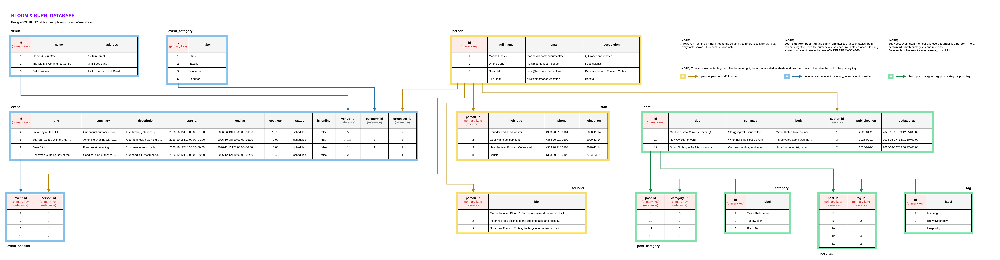

# Notes

This file is the build log: the commands, files and checks, in the order the project was built.

<br>

## Contents

- [Goal](#goal)
- [Out of scope](#out-of-scope)

**Build log steps in development order:**

1. [Local Git setup](#1-local-git-setup)
2. [Add project guide for Claude Code](#2-add-project-guide-for-claude-code)
3. [Coding guidelines](#3-coding-guidelines)
4. [Set up the Express server](#4-set-up-the-express-server)
5. [Create API routes](#5-create-api-routes)
6. [Integrate a database (PostgreSQL)](#6-integrate-a-database-postgresql)
7. [CI workflow](#7-ci-workflow)
8. [Move the backend into `backend/`](#8-move-the-backend-into-backend)
9. [React frontend](#9-react-frontend)

<br>

## Goal

The project teaches how an **Express** server is set up in **TypeScript** by building a small JSON REST API. The data is stored in **PostgreSQL**, and a **React** frontend calls the API.

<br>

## Out of scope

- **Sign-in and sign-up:** there is none; every staff member may create, edit and delete posts. The Author dropdown chooses who wrote the post; without sign-in, the API cannot check who sent the request.
- **Protected routes:** no page or endpoint checks who is calling.
- **Detailed input validation:** the browser checks only that each field is filled in (`required`), and the API checks only that `title`, `summary` and `body` are non-empty strings, that `author_id`, `category_ids` and `tag_ids` hold integers, and that `published_on` is a real date in the form `YYYY-MM-DD` (otherwise it answers `400`). A post id that is not an integer gets `404` from `checkPostId`, before any query. The database still enforces its own rules, such as unique labels and required columns.
- **Error screens:** the UI shows the API's error message as plain text. There are no error pages, toast messages or retry buttons.
- **Pages beyond the blog:** About, Events, Contact and the footer links show the not-found page.
- **Mobile layout:** the UI is designed for desktop screens only.
- **Automated tests:** the endpoints are checked by hand with `backend/blog.http`.
- **Deployment:** the app runs only on a local machine.

> The workaround for the out-of-scope parts, and the reasons for it, are in [info_out_of_scope_workaround.md](docs/notes/info_out_of_scope_workaround.md).

<br>

**Build log steps in development order:**

## 1. Local Git setup

Run once after cloning, so local merges into `main` create a merge commit (like merging a PR on GitHub) while `git pull` still fast-forwards:

```bash
git config merge.ff false   # merges always create a merge commit
git config pull.ff only     # pulls only fast-forward, with no extra merge commits
npm install                 # sets core.hooksPath to .husky/_ (see step 3)
```

The `prepare-commit-msg` hook rewrites merge messages to `chore: merge branch '<name>'`. It started in `.githooks/` and moved to `.husky/` during coding guidance setup.

**Notes:**

- **File name:** Git runs a hook only if its file name matches the hook name exactly, with hyphens (`prepare-commit-msg`). Git ignores a file named `prepare_commit_msg` and shows no error.
- **Location:** Git looks for hooks in `.git/hooks/` by default. `core.hooksPath` points it to another folder, here `.husky/_/`.
- **Permissions:** Git runs a hook file only if it is executable (`chmod +x`). Husky's wrappers in `.husky/_/` are executable; they run the scripts in `.husky/` with `sh`, so those scripts need no executable bit.

<br>

## 2. Add project guide for Claude Code

[CLAUDE.md](CLAUDE.md) gives Claude Code the project context, the repository layout and the docs to read for each layer. The rules in `.claude/rules/` set how Claude works and writes, the `/commit` skill in `.claude/skills/` prepares commits, and `.claude/settings.json` holds the permissions.

<br>

## 3. Coding guidelines

The project uses **ESLint**, **Prettier**, **Husky** and **lint-staged** to keep the code consistent. Every commit is linted and formatted automatically.

See the set-up manual: [Coding guidelines](docs/notes/manual_coding_guidelines.md).

- **Files:** `package.json`, `.prettierrc.json`, `.prettierignore`, `eslint.config.js`, `.husky/pre-commit` and `.husky/prepare-commit-msg`.
- **Hook move:** `prepare-commit-msg` moved from `.githooks/` to `.husky/`. The `prepare` script (`husky`) sets `core.hooksPath` to `.husky/_` on every `npm install`.
- **Checks:** `npm run prettier`, `npm run lint`, `npm run lint:prettier-conflicts`, `npx lint-staged` and `git config core.hooksPath`. The manual lists the expected output of each.
- **Known audit warning:** `npm audit` reports 7 moderate warnings from one `minimatch` advisory inside `typescript-eslint`. It affects only a local dev tool. `npm audit fix --force` would downgrade `typescript-eslint` to 8.36.0, so it is not run.

<br>

## 4. Set up the Express server

In this phase, Express sits in the repository root, next to the shared tooling. It moves to `backend/` in a later phase.

### 4.1 Check the project settings

The root `package.json` from step 3 already holds the settings the server needs:

| Setting                          | Reason                                                                                                                                                                       |
| -------------------------------- | ---------------------------------------------------------------------------------------------------------------------------------------------------------------------------- |
| `"type": "module"`               | The server uses ES modules (`import`/`export`). npm 11 writes `"type": "commonjs"` by default, and `verbatimModuleSyntax` (step 4.4) rejects `import` in a CommonJS package. |
| `"private": true`                | npm refuses to publish a private package, which prevents an accidental `npm publish`.                                                                                        |
| No `"main"`                      | `"main"` names the file loaded when another project imports this one as a library. This project is a server, not a library.                                                  |
| `"volta": { "node": "24.14.0" }` | Volta runs Node.js 24.14.0 (with its bundled npm 11.9.0) in this folder, whatever the global default is.                                                                     |

<br>

### 4.2 Choose how to run TypeScript

**Decision:** Node.js type stripping. Node.js removes the type annotations itself and runs the `.ts` files directly, with no build step and no extra tool. `node --watch src/server.ts` runs the server, and `tsc --noEmit` checks the types. See details: [TypeScript set-up](docs/notes/info_typescript_setup.md).

- **File extensions in imports:** write `import { app } from './app.ts'`, not `'./app'`.

Both commands become npm scripts in step 4.6.

<br>

### 4.3 Install dependencies

Run in the repository root:

```bash
npm install express
npm install --save-dev @types/node@24 @types/express
```

- **`@types/node@24`:** the type definitions must match the Node.js major version that runs the code. Without `@24`, npm installs the newest types (Node.js 26), and the editor would accept APIs that Node.js 24 does not have.
- **No `typescript` install:** step 3 already added `typescript` (`~6.0.3`) to the root `package.json`.

| Package                            | Purpose                                                                            |
| ---------------------------------- | ---------------------------------------------------------------------------------- |
| `express`                          | The Express framework for building the server.                                     |
| `typescript`                       | The TypeScript compiler; here it only checks types (`tsc --noEmit`).               |
| `@types/node` and `@types/express` | Type definitions; the editor and `tsc` use them to check Node.js and Express code. |

<br>

### 4.4 Configure TypeScript

Run in the repository root:

```bash
npx tsc --init
```

The generated `tsconfig.json` is long and mostly comments. Replace its content with:

```json
{
  "compilerOptions": {
    "module": "nodenext",
    "strict": true,
    "types": ["node"],
    "noEmit": true,
    "allowImportingTsExtensions": true,
    "verbatimModuleSyntax": true,
    "erasableSyntaxOnly": true
  },
  "include": ["src"]
}
```

- **`"include": ["src"]`:** `tsc` checks only the server code, not root files such as `eslint.config.js`.
- **No input files yet:** until `src/` holds a `.ts` file, `npx tsc --noEmit` reports "No inputs were found". This is expected.

See details: [`tsconfig.json` settings](docs/notes/info_typescript_setup.md#tsconfigjson-settings).

<br>

### 4.5 Create the Express server

- **`src/app.ts`:** says what the app does: its routes and, later, its middleware.
- **`src/server.ts`:** says how it runs: which port it listens on. It imports the app with `import { app } from './app.ts'`.
- **Port 8000:** the Vite dev server will proxy `/api` to `http://localhost:8000` (see [api_endpoints.md](docs/claude/api_endpoints.md)).

<br>

### 4.6 Add the npm scripts

Run in the repository root:

```bash
npm pkg set scripts.dev="node --watch src/server.ts"
npm pkg set scripts.start="node src/server.ts"
npm pkg set scripts.typecheck="tsc --noEmit"
```

The three scripts join the Prettier, ESLint and Husky scripts from step 3:

```json
"dev": "node --watch src/server.ts",
"start": "node src/server.ts",
"typecheck": "tsc --noEmit"
```

- **`start`:** runs the server once, without restarting it when a file changes.

See details: [The npm scripts](docs/notes/info_typescript_setup.md#the-npm-scripts).

<br>

### 4.7 Check the server

Run in the repository root:

```bash
npm run dev
```

Expected output:

```text
Server listening on http://localhost:8000
```

In a second terminal:

```bash
curl -i http://localhost:8000/
```

Expected result: `HTTP/1.1 200 OK`, a `Content-Type: application/json; charset=utf-8` header, and the body `{"message":"Hello from Express"}`. The browser at `http://localhost:8000` shows the same JSON.

`curl -i http://localhost:8000/nothing` returns `404` with an HTML page. This is Express's built-in "no route matched" answer; a later step replaces it with a JSON 404 handler.

Check the types:

```bash
npm run typecheck
```

Expected result: no output and no errors.

<br>

## 5. Create API routes

Blog post endpoints:

| Method   | Path            | Purpose        | Called from                   |
| -------- | --------------- | -------------- | ----------------------------- |
| `GET`    | `/api/blog`     | List all posts | `/blog`                       |
| `GET`    | `/api/blog/:id` | Read one post  | `/blog/:id`, `/blog/:id/edit` |
| `POST`   | `/api/blog`     | Create a post  | Save on `/blog/new`           |
| `PUT`    | `/api/blog/:id` | Replace a post | Save on `/blog/:id/edit`      |
| `DELETE` | `/api/blog/:id` | Delete a post  | Delete on `/blog/:id`         |

Tested through the REST Client extension in VS Code (`blog.http`).

<br>

## 6. Integrate a database (PostgreSQL)

**Goal:** move the data from the in-memory array to PostgreSQL. The endpoints and the contract stay the same; only the data layer behind the routes changes.

- **Data survives restarts:** PostgreSQL keeps its data in a Docker volume, so the data is still there after the server or the container restarts.



**Decision:** the `pg` client with `@types/pg`, PostgreSQL alone in Docker, and the settings in a `.env` file read by `node --env-file=.env`. See details: [Database set-up](docs/notes/info_db_setup.md).

<br>

### Order of work

The work has two stages. The first adds the database and connects the server to it; the route handlers do not change. The second moves the handlers to SQL queries.

**Stage 1: database and connection**

1. **Container:** `docker-compose.yaml` and `.env.example`. Start the container and connect with `psql`.
2. **Schema and seed data:** SQL files in `db/init/` create the tables and load the CSV files from `db/seed/`. The container runs them only when the volume is empty.
3. **Connection pool:** install `pg` and add `src/db/pool.ts`. The server checks the connection at start-up.

**Stage 2: SQL queries in the handlers**

4. **Handlers:** move each handler to a SQL query, one at a time. Each handler becomes `async` and wraps its query in `try/catch`, which answers `500` when the query fails.
5. **Clean-up:** delete the in-memory array and the id counter. PostgreSQL creates the ids.

<br>

### Docker set-up

| File                  | Committed         | Purpose                                                           |
| --------------------- | ----------------- | ----------------------------------------------------------------- |
| `docker-compose.yaml` | Yes               | Defines the PostgreSQL container.                                 |
| `.env.example`        | Yes               | Lists the variable names with sample values.                      |
| `.env`                | No (`.gitignore`) | Holds the real values. You create it as a copy of `.env.example`. |

See details: [Key lines in `docker-compose.yaml`](docs/notes/info_db_setup.md#key-lines-in-docker-composeyaml).

<br>

### Check: the database container

**Port clash:** only one container can publish port 5432. Stop any other PostgreSQL container first, or `up` fails with "port is already allocated".

In the project folder:

```bash
cp .env.example .env    # then set real values in .env
docker compose up -d
docker compose ps
docker compose exec db sh -c 'psql -U "$POSTGRES_USER" -d "$POSTGRES_DB" -c "SELECT version();"'
```

- **`sh -c`:** runs the command inside the container, where `POSTGRES_USER` and `POSTGRES_DB` are already set from `.env`. The command works as it is, with no values to replace.
- **Single quotes outside:** the host shell passes the whole command to the container unchanged.
- **Double quotes inside:** the container's shell fills in the two variables and passes the SQL to `psql` as one argument.
- **Never type `<user>` as it is:** in bash, `<` reads input from a file, so `-U <user>` fails with "user: No such file or directory".

**Expected result:**

- `docker compose ps` shows the `db` service with the status `Up`.
- `psql` prints one row that starts with `PostgreSQL 18.`.
- `psql` does not ask for a password. It runs inside the container and connects through a local socket, which the image trusts. The password matters only for connections from outside the container, such as the Express app.

<br>

### Check: schema and seed data

The container runs the files in `db/init/` on its first start, when the volume is empty. To run them again, use `docker compose down -v` and then `docker compose up -d`.

In the project folder:

```bash
docker compose logs db | grep -iE 'error|COPY'
docker compose exec db sh -c 'psql -U "$POSTGRES_USER" -d "$POSTGRES_DB" -c "\dt"'
docker compose exec db sh -c 'psql -U "$POSTGRES_USER" -d "$POSTGRES_DB" -c "SELECT count(*) FROM post;"'
```

- **`\dt`:** a `psql` command that lists the tables.

**Expected result:**

- The logs show one `COPY <n>` line per CSV file and no `ERROR` line.
- `\dt` lists 12 tables, from `category` to `venue`.
- `count(*)` returns `12`, the number of rows in `db/seed/post.csv`.

<br>

### Stop and reset

```bash
docker compose down
```

- stops and removes the container; the volume and its data stay.

```bash
docker compose down -v
```

- also deletes the volume, so the next `up` starts with an empty database.

<br>

### Install the database client

Run in the repository root:

```bash
npm install pg
npm install --save-dev @types/pg
```

- **`pg` in `dependencies`:** the server needs it at run time to talk to PostgreSQL, like `express`.
- **`@types/pg` in `devDependencies`:** only the type checker and the editor use the type definitions.

**Expected result:** `package.json` lists `pg` under `dependencies` and `@types/pg` under `devDependencies`.

<br>

### Connect the server at start-up

Load `.env` in both scripts, so `process.env.DATABASE_URL` is set. Run in the repository root:

```bash
npm pkg set scripts.dev="node --env-file=.env --watch src/server.ts"
npm pkg set scripts.start="node --env-file=.env src/server.ts"
```

| File             | Change                                                                                 |
| ---------------- | -------------------------------------------------------------------------------------- |
| `src/db/pool.ts` | Creates one shared `pg.Pool` from `DATABASE_URL` and keeps `date` columns as text.     |
| `src/server.ts`  | Runs `SELECT 1` through the pool before `app.listen`; a failed query stops the server. |

- **Top-level `await`:** `server.ts` is an ES module (`"type": "module"`), so it can wait for the query outside a function.
- **Why at start-up:** without the check, the server starts and the first request fails instead.

<br>

### Check: the server reaches the database

With the container running, in the repository root:

```bash
npm run dev
```

**Expected result:** `Server listening on http://localhost:8000`, as before.

Stop the server, then stop the container and start the server again:

```bash
docker compose stop
npm run dev
```

**Expected result:** an `ECONNREFUSED 127.0.0.1:5432` error and no `Server listening` line. `--watch` waits for a file change instead of exiting; stop it with `Ctrl+C`. Start the container again with `docker compose start`.

<br>

## 7. CI workflow

**One workflow file, one job:** [`ci.yml`](.github/workflows/ci.yml) holds one job, `checks`. It runs Prettier, ESLint and `tsc` from the root.

- **One file:** all checks start on the same events (a pull request, a push to `main`). One file declares the trigger, the permissions and the cancel rule once, and GitHub shows the result as one CI run.
- **One job:** the repository has one package in the root, so the checks share one `npm ci`. A second job would set up Node.js and install the same packages again.
- **The same checks as on the laptop:** the job runs the npm scripts from `package.json`, so a local run and the CI run check the same rules.
- **Later, one job per area:** when the code moves into `backend/` and `frontend/`, split the job so each one installs only its own lock file and a failure names the area.
- **Separate files instead:** useful when the apps need different triggers, for example a backend workflow that runs only when `backend/` changes. Here every check runs on every change, so one file is enough.

<br>

## 8. Move the backend into `backend/`

**Goal:** prepare the repository for a React frontend. The backend becomes its own npm package in `backend/`; `frontend/` will be a second one.

**Decision:** two independent npm packages, not npm workspaces. Each folder has its own `node_modules` and lock file, and its scripts run inside that folder. Workspaces would save one `npm install`, but they add hoisting, which this project does not need.

| What                                                       | Where                   | Reason                                                                                                                         |
| ---------------------------------------------------------- | ----------------------- | ------------------------------------------------------------------------------------------------------------------------------ |
| `src/`, `tsconfig.json`, `eslint.config.js`, `blog.http`   | `backend/`              | They belong to the Express API only.                                                                                           |
| Express, `pg`, ESLint, the `@types/*` packages, TypeScript | `backend/package.json`  | The backend and the frontend need different ESLint rules and globals.                                                          |
| Prettier, its plugin, Husky, lint-staged, TypeScript       | the root `package.json` | Prettier's config and the Git hooks serve the whole repository; `prettier-plugin-organize-imports` needs TypeScript as a peer. |
| `.env`, `docker-compose.yaml`, `db/`                       | the root                | Docker Compose reads `.env` next to `docker-compose.yaml`. The backend scripts read the same file with `--env-file=../.env`.   |

1. **Move the files:** `git mv` keeps the history; `git log --follow backend/src/app.ts` shows the commits from before the move. The imports and `"include": ["src"]` are relative, so no file content changes.

   ```bash
   mkdir backend
   git mv src tsconfig.json eslint.config.js blog.http backend/
   ```

2. **Split `package.json`:** copy the old lock file into `backend/` before the first install. `npm install` then removes the entries that `backend/package.json` does not list and keeps the exact versions.

   ```bash
   cp package-lock.json backend/package-lock.json
   cd backend && npm install && cd ..
   npm install
   ```

   `backend/package.json` takes the Node.js version from the root with `"volta": { "extends": "../package.json" }`.

3. **lint-staged:** `backend/package.json` has its own `lint-staged` block. For each staged file, lint-staged uses the closest config and runs its tasks in that config's folder, so `eslint --fix` finds the ESLint in `backend/node_modules`. The configs are not merged, so the backend block lists Prettier as well.

4. **CI:** [`ci.yml`](.github/workflows/ci.yml) now has two jobs. `format` runs Prettier from the root. `backend` runs ESLint and `tsc`; `defaults.run.working-directory: backend` starts every `run` step in `backend/`, and `cache-dependency-path: backend/package-lock.json` keys the npm cache on the backend lock file.

### Check: the server runs from `backend/`

```bash
cd backend
npm run dev
curl localhost:8000/api/blog
```

**Expected result:** `200` and the same posts as before the move.

### Check: the commit hook

```bash
npx lint-staged --diff=HEAD --verbose
```

**Expected result:** the files in `backend/` match the backend config (ESLint, then Prettier), the root files match the root config, and every task completes. `--diff=HEAD` checks the changed files without staging them.

<br>

## 9. React frontend

**Goal:** a React app in `frontend/` that shows the blog and calls the API. It was built in phases: first static pages with placeholder data, then the API calls.

- **Vite proxy:** the dev server forwards `/api` requests to `http://localhost:8000`. The browser sees one origin, so the backend needs no CORS.

### Check: the app runs

```bash
docker compose up -d           # in the root
cd backend && npm run dev      # first terminal
cd frontend && npm run dev     # second terminal
```

**Expected result:** `http://localhost:5173/blog` lists the posts, newest first. A new post, an edit and a delete appear in the list. With the backend stopped, the page shows "Cannot reach the server. Check that the backend is running."
