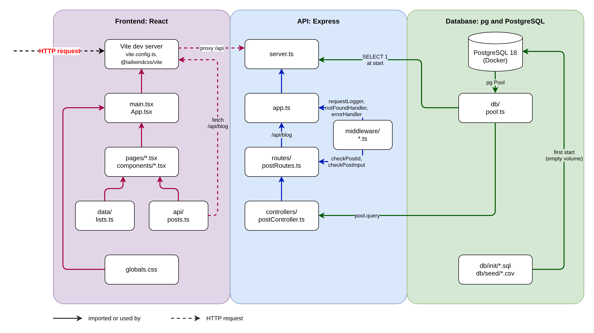
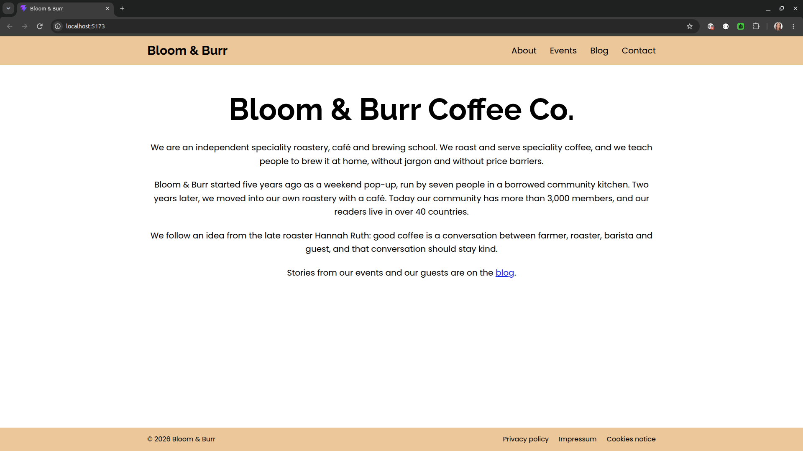
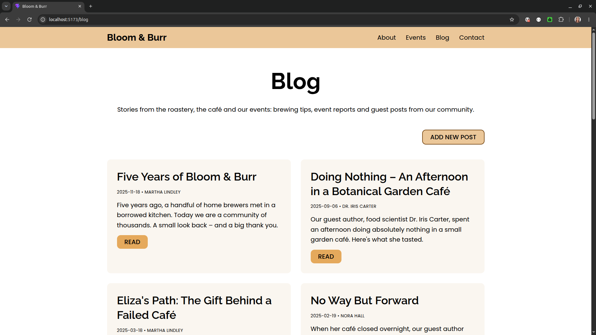
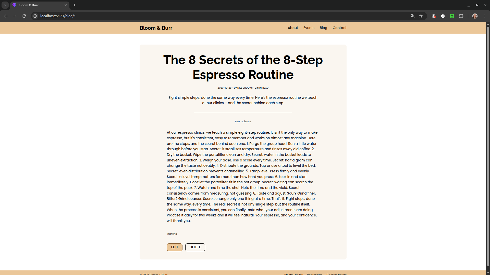
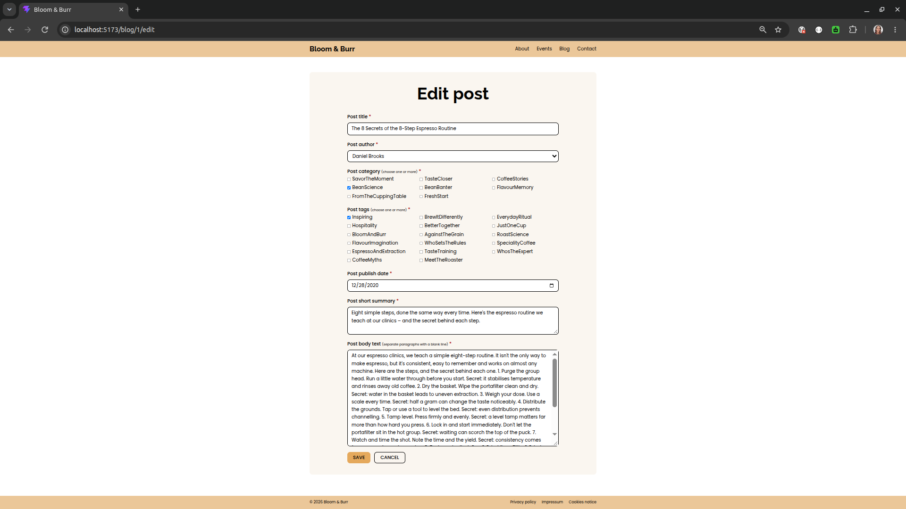
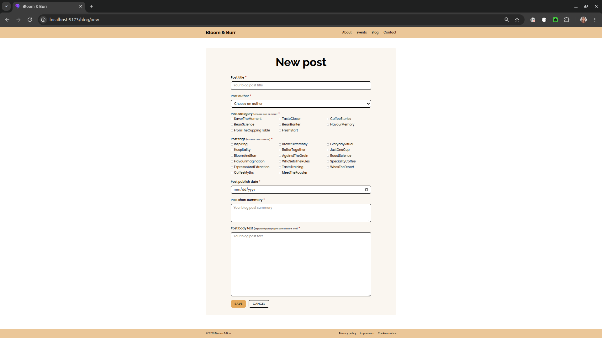

# Content hub: a JSON REST API with Express, TypeScript and PostgreSQL

This is a learning project to understand how an **Express** server is set up, in **TypeScript**, by building a small JSON REST API, and to add a **React** frontend that calls it.

> The full build log, step by step, is in [NOTES.md](NOTES.md).

> The app has no sign-in or sign-up and only the blog post endpoints. The workaround for the missing parts, and the reasons for it, are in [info_out_of_scope_workaround.md](docs/notes/info_out_of_scope_workaround.md).

> **Authorship note:** Planned by me, implemented with Claude Code. Content by me, wording by Claude.

<br>

## Architecture



Solid arrows point from a file to the file that uses it; dashed arrows are HTTP requests.

<br>

## Technical details

| Item             | Version         |
| ---------------- | --------------- |
| Operating system | Linux Mint 21.2 |
| Node.js          | v24.14.0        |
| npm              | 11.9.0          |
| Volta            | 1.1.1           |
| TypeScript       | 6.0.3           |
| Express          | 5.3.0           |
| React            | 19.3.1          |
| Vite             | 8.3.8           |
| Tailwind CSS     | 4.3.5           |
| PostgreSQL       | 18 (Docker)     |

<br>

## Start the app

Requirements: Node.js, npm and Docker with Docker Compose. Run each command in the repository root, except where a step says `backend/` or `frontend/`.

1. **Install the dependencies:** the root holds the formatting tools and the Git hooks; `backend/` holds the Express API; `frontend/` holds the React app.

   ```bash
   npm install
   cd backend && npm install && cd ..
   cd frontend && npm install && cd ..
   ```

2. **Create `.env`:** copy the example, then set a real user, password and database name. `DATABASE_URL` must use the same three values.

   ```bash
   cp .env.example .env
   ```

3. **Start the database:** on its first start, the container creates the tables and loads the seed data from `db/`.

   ```bash
   docker compose up -d
   ```

4. **Start the server (in `backend/`):** the scripts read `.env` from the root.

   ```bash
   cd backend
   npm run dev
   ```

   **Expected result:** `Server listening on http://localhost:8000`. The API is at `http://localhost:8000/api/blog`.

5. **Start the frontend (in `frontend/`, in a second terminal):** the Vite dev server reloads the page on every saved change.

   ```bash
   cd frontend
   npm run dev
   ```

   **Expected result:** Vite prints `Local: http://localhost:5173/`. The app is at that address.

6. **Stop:** press `Ctrl+C` in both terminals, then stop the database. The data stays in the Docker volume.

   ```bash
   docker compose down
   ```

<br>

## Evolution roadmap

The planned evolution roadmap of the repo. Each version is built in phases: see the [backend roadmap](docs/claude/evolution_roadmap_backend.md) and the [frontend roadmap](docs/claude/evolution_roadmap_frontend.md).

- v1: API endpoint development with in-memory storage, tested through the REST Client extension in VS Code (`backend/blog.http`)
- v2: PostgreSQL integration
- v3: simple frontend with React

<br>

## Page snapshots





_Note: the next three images were taken at different zoom levels, so that each page fits on one screen._






