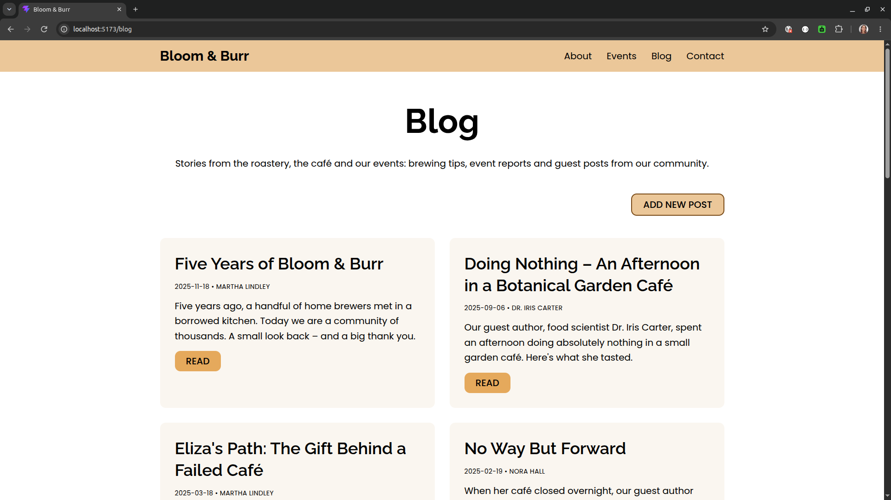
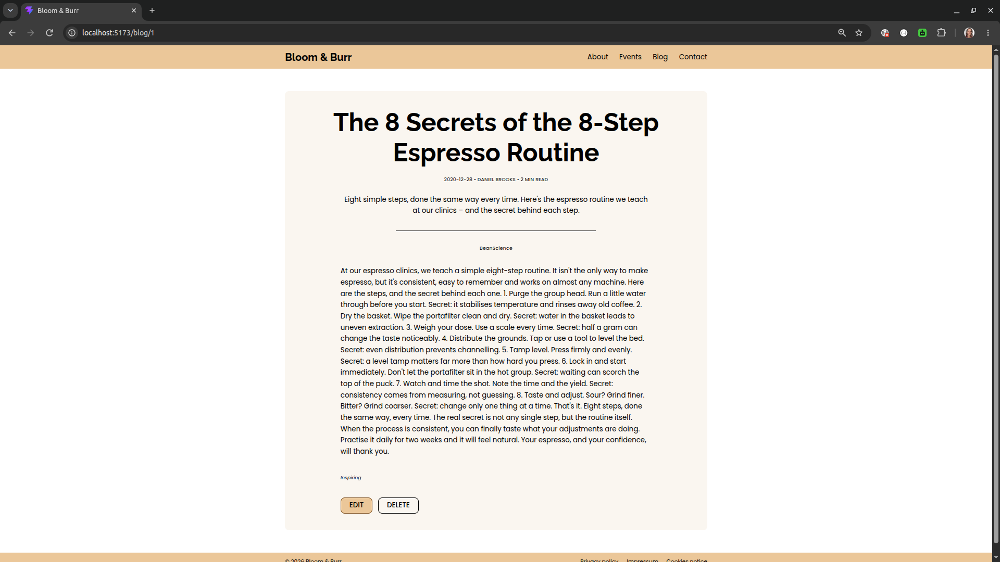
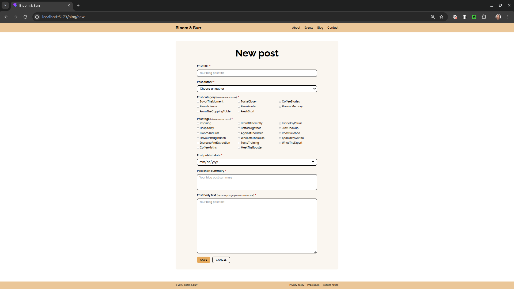

# Workaround for the out-of-scope parts

> This is a blog app for a fictional coffee company. To keep it simple, it has no sign-in or sign-up, and the Express server has only the blog post endpoints that a real app would need. The missing parts needed a workaround, and this file explains it.

> **The workaround in short:** the frontend sends ids, the backend stores ids, and the frontend turns the ids into names and labels from hard-coded lists.

 

## API endpoints

There are only the five blog post endpoints, and no endpoints for authors, categories or tags. The full contract is in [api_endpoints.md: post endpoints](../claude/api_endpoints.md#post-endpoints).

| Method   | Path            | Purpose        | Success           | Errors                             |
| -------- | --------------- | -------------- | ----------------- | ---------------------------------- |
| `GET`    | `/api/blog`     | List all posts | 200, array        | 500                                |
| `GET`    | `/api/blog/:id` | Read one post  | 200, post         | 404, 500                           |
| `POST`   | `/api/blog`     | Create a post  | 201, the new post | 400 (body or unknown id), 500      |
| `PUT`    | `/api/blog/:id` | Replace a post | 200, the post     | 400 (body or unknown id), 404, 500 |
| `DELETE` | `/api/blog/:id` | Delete a post  | 204, no body      | 404, 500                           |

An unknown route gets `404 { error: 'Route not found' }`. A body that is not valid JSON gets `400 { error: 'Invalid JSON body' }`.

### API implementation

The API was built in three stages:

1. **In-memory Express:** tested with `backend/blog.http`. The in-memory array is gone now; `backend/src/data/posts.ts` keeps only the types.
2. **Express with PostgreSQL:** the handlers query the database.
3. **React frontend:** it calls the API through the Vite proxy (`/api` → `http://localhost:8000`), so the backend needs no CORS.

 

## Out of scope

The list is in [NOTES.md: out of scope](../../NOTES.md#out-of-scope).  
In short: there is no sign-in or sign-up, and validation and error handling are simple.

 

## Blog pages

### Blog list page

Each card shows:

- the title
- the published date and the author name, separated by `•`
- the summary
- a Read button

### Single post page

The page shows:

- the title
- the published date, the author and the reading time (`<minutes_to_read> min read`), separated by `•`
- the summary
- the categories, joined with `•`
- the body, split into paragraphs at `'\n\n'`. A body with `\r\n` line endings, or with spaces on the "blank" line, stays one paragraph.
- the tags, joined with `, `
- the Edit and Delete buttons; Delete asks for confirmation (`confirm()`) first

### Create and edit post

One component (`PostForm.tsx`) serves both `/blog/new` and `/blog/:id/edit`. Its fields are:

- title
- author (dropdown)
- categories (checkboxes)
- tags (checkboxes)
- published date (`<input type="date">`)
- summary
- body

Every field is required, and each checkbox group needs at least one ticked box.

 

## Workaround: the chosen solution

### Author

- The frontend sends `author_id`.
- The dropdown is filled from the hard-coded `STAFF` list in `frontend/src/data/lists.ts`. It holds **ids 1–9**: everyone in `staff.csv` (9 rows, including Ellie Dean and Andrew Fletcher).
- Each `<option>` has `value={id}` and shows `full_name`, so the id comes straight from the dropdown. No separate name-to-id map is needed.
- The API returns only `author_id`. The frontend looks up the name in `STAFF`.
- The backend does not check that the author is a staff member. The foreign key checks only that the id exists in `person`, so `author_id: 10` (Theo Oakley, not staff) is accepted when it is sent from REST Client.
- The frontend cannot find id 10 in `STAFF`, so the card and the post page show an empty author slot (`2026-01-01 •  • 2 min read`). The same happens with any category or tag id that is not in the hard-coded lists.

### Categories and tags

- The frontend sends `category_ids` and `tag_ids`.
- The labels are hard-coded in `frontend/src/data/lists.ts`, as a copy of `category.csv` and `tag.csv`.
- The API returns only the id arrays. The frontend looks up the labels in its lists.

### Date

- The frontend sends `published_on` from `<input type="date">`, which is already in the form `YYYY-MM-DD`.
- The backend checks that it is a real calendar date, so `2026-02-30` is rejected.
- The backend sets `updated_at` with `now()` in SQL.

### Minutes to read

The backend calculates the reading time on every response: 200 words per minute, and at least 1 minute. It stayed in the backend after the frontend was built.

 

## Validation

- **Frontend:** every field has the `required` attribute. In a checkbox group, every box is `required` until one is ticked.
- **Backend:** the `checkPostInput` middleware checks that:
  - `title`, `summary` and `body` are non-empty strings, and trims them
  - `author_id` is an integer
  - `category_ids` and `tag_ids` are arrays of integers. **Empty arrays are accepted**, so the API can create a post with no category.
  - `published_on` is a real date in the form `YYYY-MM-DD`
- **PostgreSQL:** the `NOT NULL` constraints and the foreign keys.

 

## Error handling

- **Foreign key violation:** the PostgreSQL error `23503` becomes `400 'Author, category or tag does not exist'`. The message cannot say which id is wrong.
- **Duplicate id in a list:** `category_ids: [1, 1]` breaks the primary key (`23505`). The handlers do not catch it, so the client gets a 500.
- **Post id range:** `checkPostId` accepts any value that `Number.isInteger` accepts. `/api/blog/99999999999` passes the check, then fails in PostgreSQL as out of range for `integer`, so the client gets a 500 instead of a 404. `/api/blog/1e2` is read as post 100.
- **Any other error:** it goes to `errorHandler`, which logs it on the server and answers 500.
- **Frontend:** a failed `fetch` or a proxy 502 shows "Cannot reach the server. Check that the backend is running." An API error shows its `error` text. A GET with an unknown id shows the not-found page.

 

## Database queries

- **One `SELECT_POST` query:** it serves both the list and a single post. `ARRAY(SELECT … ORDER BY …)` collects `category_ids` and `tag_ids` (`{}` when there are none).
- **The list returns full posts:** the body is included, and the posts are sorted by `published_on DESC, id DESC`.
- **POST:** `BEGIN` → `INSERT` the post `… RETURNING id` → one `INSERT` per category id and per tag id (a loop) → `COMMIT` → `SELECT` the new post. All of it runs on one client from `pool.connect()`, with `ROLLBACK` in `catch` and `release()` in `finally`.
- **PUT:** `UPDATE` the post (`rowCount === 0` → 404), then `DELETE` all its link rows and insert the new ones, all in one transaction.
- **DELETE:** one statement, with no transaction. `ON DELETE CASCADE` removes the link rows.

 

## Assumptions

1. **Only staff write posts:** only the frontend dropdown enforces it.
2. **Categories, tags and staff never change:** so the frontend can hard-code them, and no endpoint is needed. The cost is that any id the lists do not know (sent through REST Client, or added to the database later) shows up as a blank name or label.
3. **The API stays thin:** it returns the stored values (ids), and the frontend does the "joins".
4. **The date belongs to the author:** the author picks it; it is not set automatically.
5. **`minutes_to_read` is calculated in the backend:** so every client gets the same number.
6. **The list returns the same data as a single post, body included:** there are few posts, so the response size does not matter.
